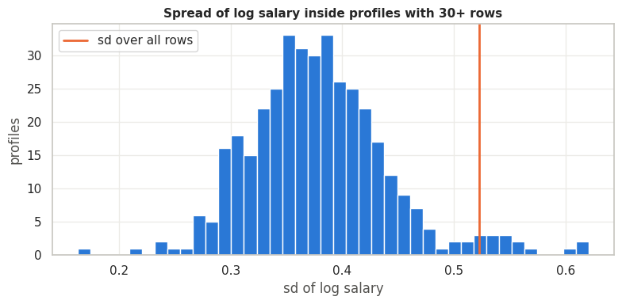
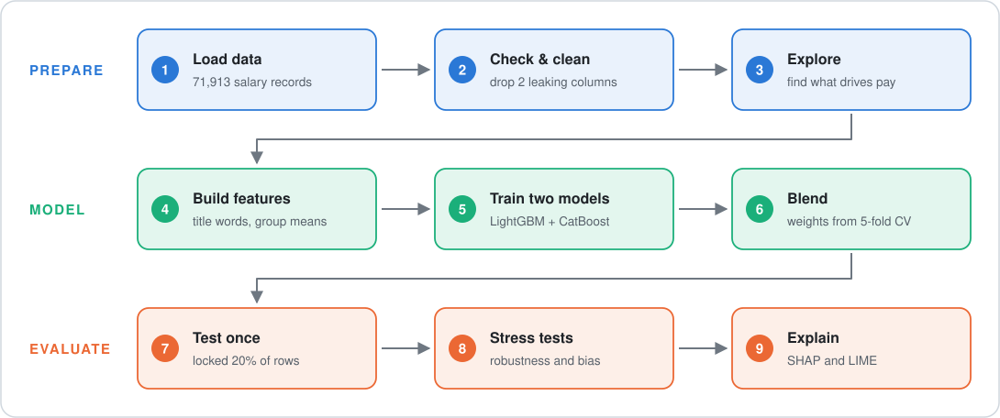
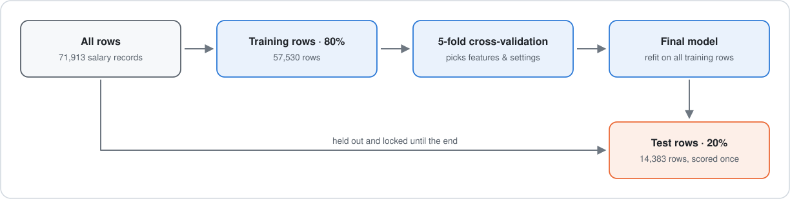
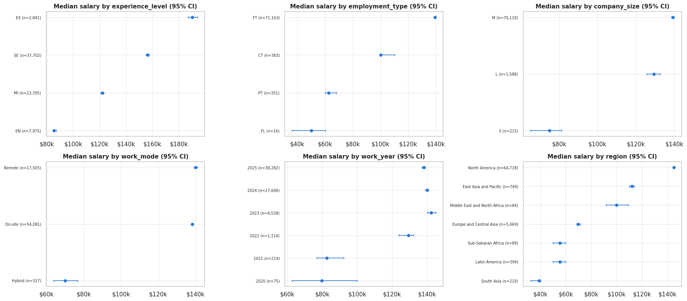
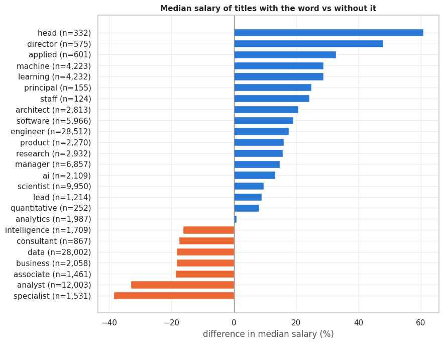
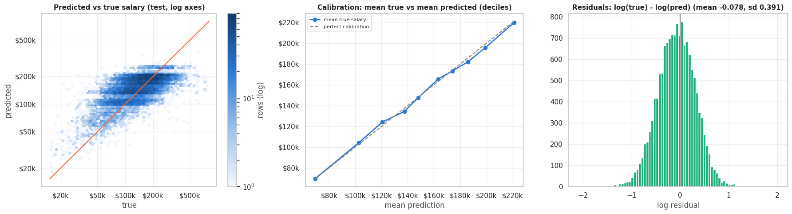
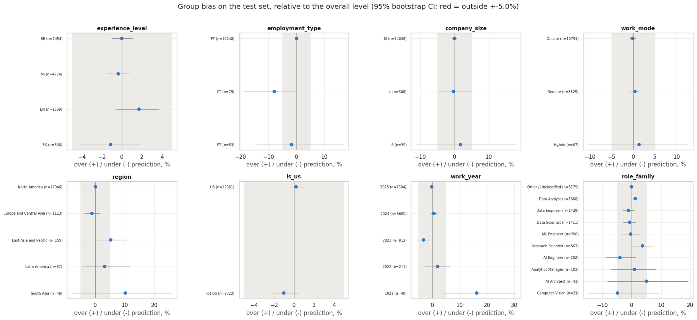
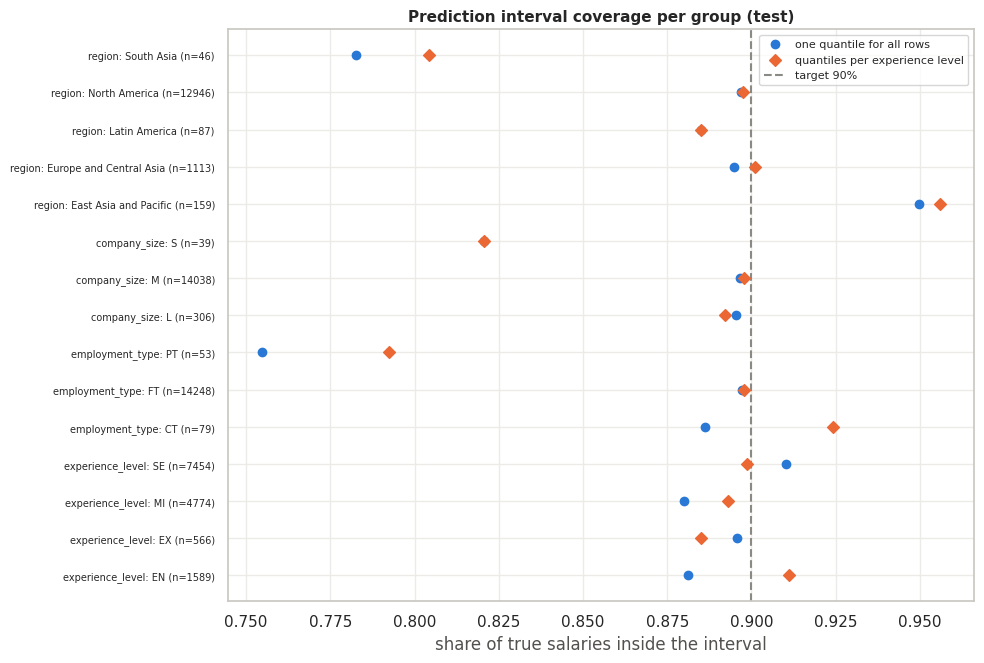
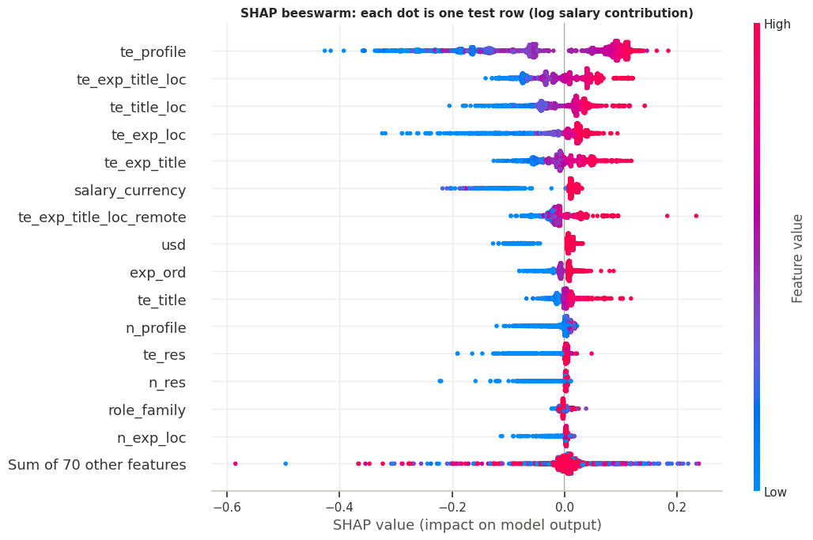
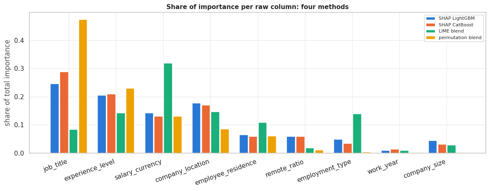

<h1 align="center">AI &amp; Data Salaries: EDA + Robust Explainable Model</h1>

<p align="center">
Predicting salaries of AI, ML and data jobs (2020 to 2025) from the job profile.<br>
The model is checked for leakage, robustness and group bias, and it is explained with SHAP and LIME.
</p>

<p align="center">
  <a href="https://www.kaggle.com/code/samirhossain2001/ai-data-salaries-eda-robust-explainable-model"></a>
  <a href="https://www.kaggle.com/datasets/debayank2024/ai-impact-on-jobs-and-salaries-2020-2026"></a>
  <a href="LICENSE"></a>
  
  
  
</p>

<p align="center">
  
  
  
  
  
  
  
  
</p>

<p align="center">
  <b>Author:</b> Md. Samir Hossain ·
  <a href="https://github.com/SamirHossain2001">GitHub</a> ·
  <a href="mailto:2001samirhossain@gmail.com">2001samirhossain@gmail.com</a>
</p>

---

## Results

Regression on `salary_in_usd`. The headline metrics are R², MAE and RMSE, in dollars.

| Evaluation | R² | MAE | RMSE |
|---|---|---|---|
| 5-fold cross-validation (training rows) | 0.3093 | $46,110 | $64,172 |
| **Hold-out test (20%, scored once)** | **0.3071** (95% CI 0.2923 to 0.3226) | **$46,368** | **$64,757** |
| 5 more random train/test splits (mean) | 0.3088 ± 0.0052 | $46,063 | $64,041 |
| Train before 2025, predict 2025 | 0.2922 | $47,080 | $66,045 |
| Simple reference: group averages | 0.2811 | $47,593 | $65,962 |

### Why R² is about 0.31
The 71,913 rows contain only **5,934 distinct job profiles**, and people with an identical profile still earn very
different salaries. Even an "oracle" that knows each profile's true average salary reaches only **R² 0.357**. The model
reaches **86%** of that ceiling. On this data, a much higher score would point to leakage.

<p align="center">
  
</p>

---

## How it works

<p align="center">
  
</p>

<p align="center">
  
</p>

- **Leakage removed:** `salary` together with `salary_currency` converts back to the target, and on its own `salary`
  explains R² 0.963 of log salary. `salary_outlier_flag` is exactly `salary_in_usd >= 332,000`. Four more columns are
  copies of other columns.
- **Features:** job-title words (seniority and domain), region, and target encodings of groups such as
  experience × title × country. The encodings are shrunk toward the overall mean and computed out-of-fold, and none is
  keyed on the year, so a future year does not look like an unseen group.
- **Models:** LightGBM on log salary (with a smearing back-transform) and CatBoost on dollars, blended with
  non-negative least squares. The weights are 0.556 and 0.445.

---

## Key findings

<p align="center">
  
</p>

- Job title has the largest effect on salary overall (epsilon² 0.198), followed by experience (0.139) and location (0.127).
- Hybrid work, small companies and freelance work look low-paid partly because they are rarely US-based: 83.6% of all
  rows are US-based, and these groups differ from that share by more than 20 points.

<p align="center">
  
</p>

---

## Checks

<p align="center">
  
</p>

- **Calibration:** the decile means of predicted and true salary differ by 1.3% on average. The model regresses toward
  the middle: the lowest true-salary decile is over-predicted by 78%, the highest under-predicted by 37%.
- **Robustness:**

  | Check | Result |
  |---|---|
  | Beats the reference on each of 5 random splits | 5 of 5 |
  | Spread of R² across model seeds (sd) | 0.00005 |
  | Leaving the highest salaries out of training | R² −0.0131 |
  | Every test job title unseen | R² −0.1131 |
  | Test rows vs training rows (adversarial AUC, 0.5 = alike) | 0.492 |

<p align="center">
  
</p>

- **Bias:** 0 of 35 groups are flagged. But "not flagged" is not "no bias": contract work (−7.9%), East Asia & Pacific
  (+5.2%) and 2021 (+16.3%) are probably biased, but the size of the bias is uncertain. South Asia and AI Architect are
  too small to tell. These test groups are small; for example, only 40 test rows are from 2021.

<p align="center">
  
</p>

- **Uncertainty:** the 90% prediction intervals cover 89.8% of test salaries (median width $190,972). They are too
  narrow for part-time work (79.2%), small companies (82.1%) and South Asia (80.4%).

---

## Explainability

<p align="center">
  
</p>

<p align="center">
  
</p>

- SHAP on LightGBM and SHAP on CatBoost rank the raw columns identically (Spearman 1.000). Permutation importance
  agrees closely (0.967): **job title first, then experience, then location and currency**.
- LIME agrees less (mean Spearman 0.578) and its local fits are rough (median R² 0.40). LIME changes columns
  independently, which creates combinations that never occur, so use it only as a rough local check.

<details>
<summary>Supplementary: accuracy views</summary>

Accuracy does not apply directly to a dollar amount, so the notebook adds two views:

| View | Result |
|---|---|
| Predictions within ±10% / ±20% / ±30% of the true salary | 20.1% / 39.0% / 55.6% |
| Salary band (4 bands: < $96k, $96k to 139k, $139k to 190k, ≥ $190k), exact | 44.9% (95% CI 44.1 to 45.8%; chance 25%) |
| Salary band, exact or neighbouring band | 81.3% |

</details>

---

## Run it

**On Kaggle (easiest):** open the [notebook](https://www.kaggle.com/code/samirhossain2001/ai-data-salaries-eda-robust-explainable-model),
attach the [dataset](https://www.kaggle.com/datasets/debayank2024/ai-impact-on-jobs-and-salaries-2020-2026) and run
all cells. It needs CPU only; the last run took 11.7 minutes. Internet is needed only if `lime` is missing, because the
first cell installs it.

**Locally:**
```bash
pip install pandas numpy scipy scikit-learn lightgbm catboost shap lime matplotlib seaborn jupyter
# download ai_jobs_salaries_clean.csv from the Kaggle dataset into a folder, then point the notebook to it:
export INPUT_ROOTS=/path/to/folder        # Windows PowerShell: $env:INPUT_ROOTS="C:\path\to\folder"
jupyter notebook ai-data-salaries-eda-robust-explainable-model.ipynb
```
Set `SMOKE = True` in the configuration cell for a quick check on a 4,000-row sample.

**Reproducibility:** every random step uses fixed seeds, and the test set is scored once. The Kaggle run and a local run
gave identical numbers to four decimals.

## Limitations
- The columns explain about a third of salary variation at most (oracle R² 0.357). A single prediction is uncertain,
  so use the prediction interval, not the point estimate.
- Predictions for new or unusual job titles are much less reliable.
- The data is self-reported and dominated by the US (84% of rows), full-time jobs and 2024 to 2025. Small groups have
  wide error bars.
- The AI-exposure scores mentioned in the dataset description are not used.

## License
Code and notebook: [MIT](LICENSE) © 2026 Md. Samir Hossain.
The salary data comes from [ai-jobs.net](https://github.com/foorilla/ai-jobs-net-salaries) (CC0 1.0), via the
[Kaggle dataset](https://www.kaggle.com/datasets/debayank2024/ai-impact-on-jobs-and-salaries-2020-2026).
